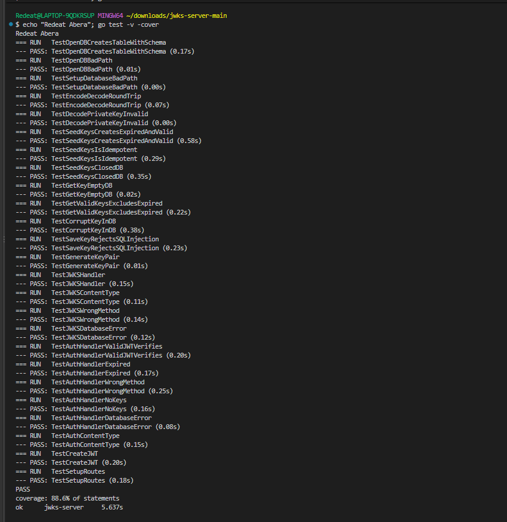
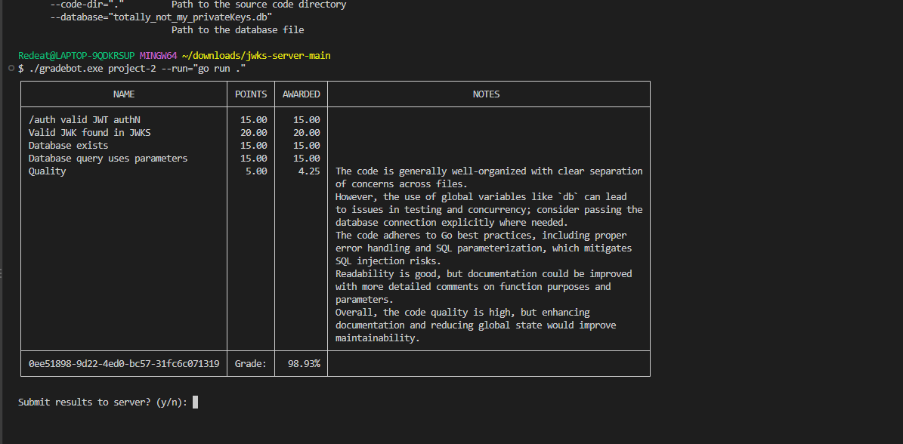

# JWKS Server – Project 2 (SQLite-backed)

A JWKS server written in Go for CSCE 3550. It stores RSA private keys in a SQLite
database, serves the public keys through a JWKS endpoint, and issues signed JWTs.

## What changed from Project 1
- Keys are no longer kept only in memory. On start the server creates/opens
  `totally_not_my_privateKeys.db` with the required table:
  ```sql
  CREATE TABLE IF NOT EXISTS keys(
      kid INTEGER PRIMARY KEY AUTOINCREMENT,
      key BLOB NOT NULL,
      exp INTEGER NOT NULL
  )
  ```
- It makes sure the DB holds one key that expired an hour ago and one valid for an hour.
- Keys are serialized to **PKCS1 PEM** before saving and parsed back when read.
- `POST /auth` and `GET /.well-known/jwks.json` read their keys from the database.
- **SQL injection protection:** every query uses `?` placeholders, so values are passed
  separately from the SQL text and are never executed as SQL.

## Files
| File | Purpose |
|---|---|
| `main.go` | Opens the DB, seeds keys, sets up routes, starts the server |
| `db.go` | Database schema, PEM encode/decode, parameterized queries |
| `driver.go` | SQLite driver import (`modernc.org/sqlite`, pure Go – no C compiler needed) |
| `handlers.go` | `/auth` and `/.well-known/jwks.json` handlers |
| `jwt.go` | Builds and signs RS256 JWTs |
| `keys.go` | RSA key generation |
| `server_test.go` | Test suite |

## How to Run
```bash
go mod tidy      # first time only: downloads the SQLite driver
go run .
```
The server starts at `http://localhost:8080`.

## Endpoints
```bash
curl http://localhost:8080/.well-known/jwks.json          # unexpired public keys
curl -X POST http://localhost:8080/auth                    # valid JWT
curl -X POST "http://localhost:8080/auth?expired=true"     # JWT signed with expired key
```
Authentication is mocked: Basic auth and a JSON body are both accepted.

## Testing
```bash
go test -v -cover
```
Linting: `gofmt -l .` (no output) and `go vet ./...` (no issues).

## Test Coverage


## Gradebot
Run from the project folder so it can find the `.db` file: `gradebot project2`



## Language
Go

## Author
Redeat Abera
